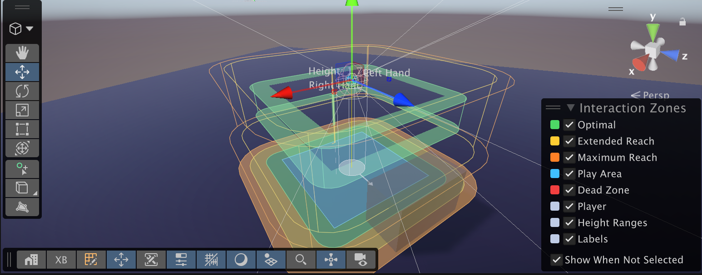
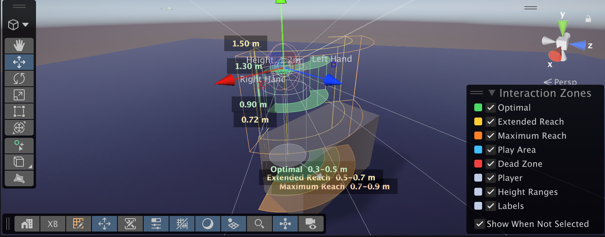
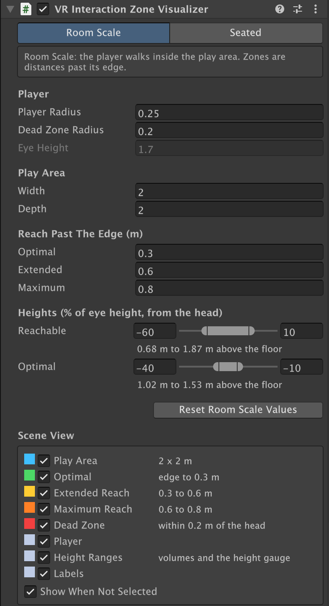

# Interaction Zones

A Scene view guide that shows where the player can comfortably reach, so you can place interactables without putting on the headset.

> **Menu path:** Component > Shababeek > Interactions > Debug > VR Interaction Zone Visualizer
> **Lives on:** the Camera Rig (the Camera Rig prefab already has one)

The zones are drawn only in the editor. They do nothing at runtime and are not included in what the player sees.

---

## Reading the zones

| Colour | Zone | Meaning |
|---|---|---|
| Green | **Optimal** | Comfortable reach. Put the things the player uses most here. |
| Yellow | **Extended Reach** | Reachable with a stretched arm. Fine for occasional use. |
| Orange | **Maximum Reach** | Reachable only by leaning. Avoid for anything important. |
| Red | **Dead Zone** | Too close to the head to use comfortably. |
| Blue | **Play Area** | Where the player can walk (Room Scale only). |

The filled bands on the floor are the footprint of each zone. With **Height Ranges** on, each zone also shows the heights it covers, and a gauge beside the player marks the reachable range and the optimal range in metres above the floor. The green volume is filled so it stands out as the place to put things.

Everything is drawn relative to the rig, so the zones turn with it. Parts hidden behind scene geometry are drawn faintly.

---

## Choosing a mode

Pick **Room Scale** or **Seated** with the two buttons at the top of the component.

- **Room Scale**: the player walks inside the play area. Zones are distances past the edge of the play area.
- **Seated**: the player stays in one spot. Zones are distances in front of the head, inside an arc.

Each mode keeps its own values. Switching mode never changes a value; it only changes which set is shown and drawn. **Reset … Values** restores the defaults of the mode you are looking at and leaves the other mode alone.

---

## Inspector

### Player

| Field | What it does |
|---|---|
| **Player Radius** | Radius of the body drawn at the rig. |
| **Dead Zone Radius** | Radius around the head that is too close to use. |
| **Eye Height** | Read only. Taken from **Camera Height** on the Camera Rig. |

### Room Scale

| Field | What it does |
|---|---|
| **Width**, **Depth** | Size of the walkable play area. |
| **Optimal** | How far past the edge is comfortable to reach. |
| **Extended** | How far past the edge a stretched arm reaches. |
| **Maximum** | The furthest the player can reach at all. |

### Seated

| Field | What it does |
|---|---|
| **Optimal** | Closest and furthest comfortable distance in front of the head. |
| **Extended** | Distance a stretched arm reaches. |
| **Maximum** | Distance the player can reach by leaning. |
| **Arc Half Angle** | How far to each side the zones extend. 180 draws a full circle. |

### Heights

Heights are a percentage of eye height, measured from the head. Negative values are below the head. The line under each slider shows the same range in metres above the floor.

| Field | What it does |
|---|---|
| **Reachable** | Lowest and highest height the player can reach. Used by the Extended and Maximum zones. |
| **Optimal** | Lowest and highest comfortable height. Always stays inside the reachable range. |

Distances are kept in order for you: Extended is never smaller than Optimal, and Maximum is never smaller than Extended.

---

## Showing and hiding parts

The **Scene View** list at the bottom of the component turns each part on or off: the three zones, the play area, the dead zone, the player, the height ranges and the labels. The same switches appear in an **Interaction Zones** panel in the Scene view while the rig, or anything under it, is selected.

These switches are your own editor preference. They are not saved in the scene or the prefab, so hiding a zone does not change the file and does not affect anyone else on the team.

**Show When Not Selected** keeps a faint footprint visible while you work on other objects. Turn it off to see the zones only while the rig is selected.

To hide everything at once, use the Scene view **Gizmos** menu and untick **VR Interaction Zone Visualizer**. If the zones never appear, check that it is ticked there.

---

## Upgrading from 1.1.0

Rigs saved with the previous version convert themselves the first time they load:

- Distances and the play area move into the mode they belonged to.
- The old layout had one set of heights shared by both modes. They go to the mode that was selected when the rig was saved; the other mode starts from its defaults.
- The per-zone **Show** tick boxes are no longer stored on the component. Use the Scene View switches instead.

Scripts that read `VRInteractionZoneVisualizer` need updating: the flat properties (`PlayAreaWidth`, `SeatedOptimalMin`, `ShowOptimalZone` and so on) are replaced by `RoomScale` and `Seated` settings objects, `ApplyVRModePreset()` by `ResetToDefaults(mode)`, and `GetPlayerHeight()` by `EyeHeight`.

---

Back to the [documentation index](../README.md).
