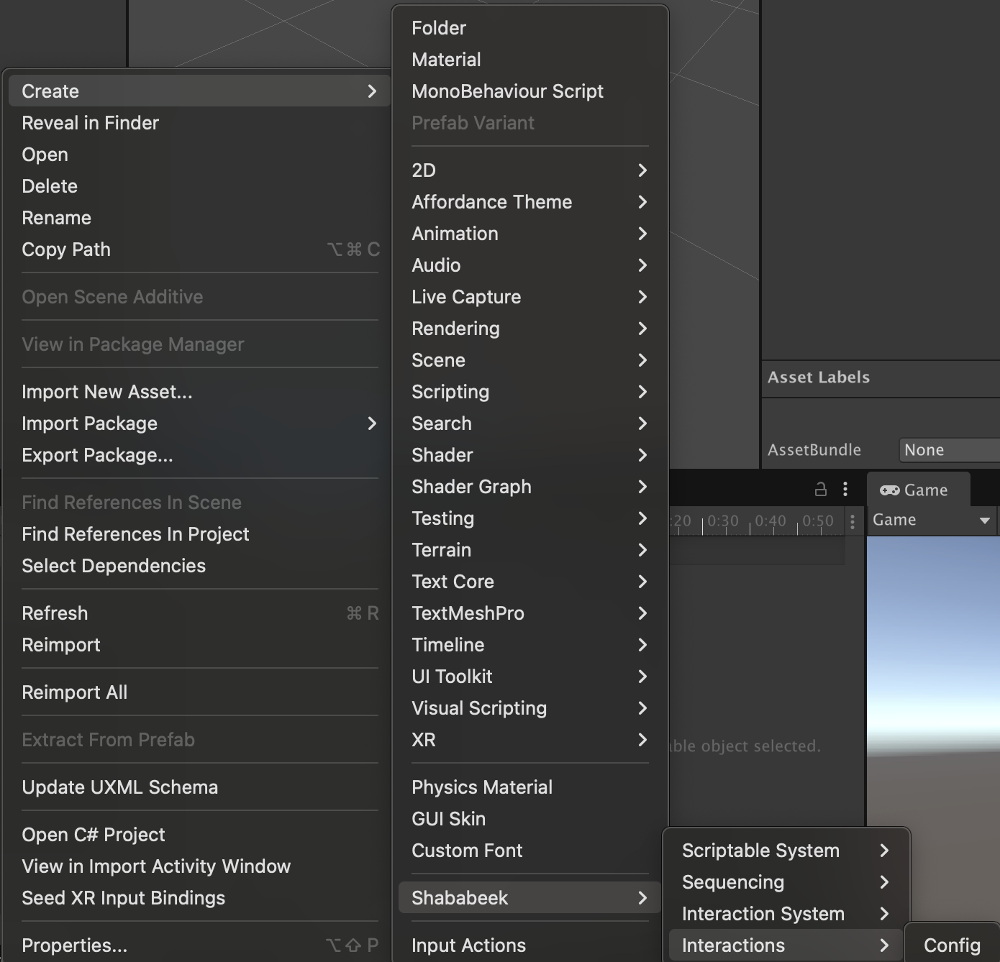

# Config Asset  Central System Configuration

## Overview

The **Config** asset is the brain of the Shababeek Interaction System. It's a ScriptableObject that stores all system-wide settings in one place, ensuring every component in your project uses the same configuration.

**Think of it as:** A central control panel for your VR interaction system.

**You only need one** Config asset per project (though you can create multiple for different scenarios).

**Key Responsibilities:**
-  **Layer Management** - Defines which layers hands and objects use
-  **Hand Configuration** - Select which hand will be used in your project
-  **Input Setup** - Manages controller input (new Input System or legacy)
-  **Physics Settings** - Controls hand physics behavior
-  **System References** - Automatically creates and manages system objects

---

## Quick Start

### Creating Your First Config

**Recommended: Use the Setup Wizard** *
1. Right-click in hierarchy or menu: **Shababeek > Setup Wizard**
2. Follow the on-screen steps
3. The wizard creates and configures everything automatically

**Manual Creation:**
1. Right-click in Project window
2. **Create > Shababeek > Interactions > Config**
3. Name it "InteractionConfig" (or similar)
4. Configure settings (see sections below)



### Where to Assign It

The Config asset is assigned in the **CameraRig** component, if you don't assign it nothing will work
Once assigned, all hands  and interactables automatically use this configuration.

---

## Inspector Reference

### Hand Configuration

#### Hand Data

**Field**: Hand Data *HandData Asset (see HandData documentation)*
**Purpose**: References the hand models, poses, and finger Masks.
**Required**: Yes (system won't work without it)

**What it does:**
- Provides hand prefabs for Use system wide
- Stores available hand poses (Default, Fist, Pointing, custom)
- Contains finger animation data and avatar masks

**Setup:**
Follow instructions in the *HandData Documentation (coming soon)*

**Troubleshooting:**
-  **"Hands not showing"**  Check HandData is assigned and has prefabs
-  **"Poses not working"**  Verify HandData has animation clips assigned

---

### Layer Configuration

Layers prevent unwanted collisions (like hands colliding with themselves), this should be automatic once you select the layers.


| Field                  | Type | Purpose | Default |
|------------------------|------|---------|---------|
| **Left Hand Layer**    | LayerMask | Layer assigned to the left hand GameObject | Create a "LeftHand" layer |
| **Right Hand Layer**   | LayerMask | Layer assigned to the right hand GameObject | Create a "RightHand" layer |
| **Interactable Layer** | LayerMask | Layer for all grabbable/interactable objects | Create an "Interactable" layer |
| **Player Layer**       | LayerMask | Layer for the player body/rig | Use Unity's "Player" layer or create custom |

**Why Layers Matter:**
- Hands won't collide with themselves (left hand vs left hand body)
- Hands won't collide with player body
- Clear separation between interactable and non-interactable objects
- Optimizes physics calculations

**Recommended Layer Setup:**

| Layer Name | Number | Used For | Collides With |
|------------|--------|----------|---------------|
| LeftHand | 8 | Left hand objects | Interactable, Environment |
| RightHand | 9 | Right hand objects | Interactable, Environment |
| Interactable | 10 | Grabbable objects | LeftHand, RightHand, Environment |
| Player | 11 | Player body | Environment (NOT hands) |

**Setup Steps:**
1. Go to **Edit > Project Settings > Tags and Layers**
2. Create the four layers listed above
3. Go to **Edit > Project Settings > Physics**
4. Configure **Layer Collision Matrix**:
 -  LeftHand can collide with Interactable
 -  RightHand can collide with Interactable
 -  LeftHand cannot collide with Player
 -  RightHand cannot collide with Player
 -  LeftHand cannot collide with LeftHand
 -  RightHand cannot collide with RightHand

<!-- IMAGE TODO: Images/Core/PhysicsLayerMatrix.png | Physics Layer Collision Matrix -->

*Physics Layer Matrix: hands, interactables, and player layers configured for VR.*

**Note:** The Setup Wizard can configure this automatically!

---

### Input Manager Settings

#### Input Type

| Property | Value |
|----------|-------|
| **Type** | Enum |
| **Options** | Controller Tracking, Hand Tracking, Both |
| **Default** | Controller Tracking |

- **Controller Tracking** reads VR controllers through the Input System actions below.
- **Hand Tracking** reads tracked hands through Unity's XR Hands package.
- **Both** uses whichever is active.

Hand Tracking and Both are only offered when the XR Hands package is installed. See [Input providers and locomotion](InputAndLocomotion.md).

#### Left / Right Hand Actions

| Property | Value |
|----------|-------|
| **Field** | Left Hand Actions / Right Hand Actions |
| **Type** | A set of Input Action references |

| Action | Description |
|--------|-------------|
| **Thumb** | Thumb curl value |
| **Index** | Index finger (trigger) value |
| **Middle** | Middle finger (grip) value |
| **Ring** | Ring finger curl value |
| **Pinky** | Pinky curl value |
| **A Button** | Primary face button (A / X) |
| **B Button** | Secondary face button (B / Y) |
| **Thumbstick** | Thumbstick axis |

**Setup:**
1. Create an Input Actions asset: **Create > Input Actions**
2. Define the actions for each hand
3. Assign them to these fields

The Setup Wizard can create and assign default input actions for you.

> Config assets created before the A / B button and thumbstick references existed leave those three empty. Assign them to use A / B button events and locomotion.

---

### Editor UI Settings

#### Feedback System Style Sheet

| Property | Value |
|----------|-------|
| **Type** | StyleSheet |
| **Purpose** | Customizes the visual appearance of feedback system UI |
| **Optional** | Yes (has default styling) |

This is for customizing the editor's UI for the feedback system. Most users don't need to change this.

---

### Hand Physics Settings

Control how hands interact with physics objects.

#### Hand Mass

| Property | Value |
|----------|-------|
| **Type** | float |
| **Default** | 30.0 |
| **Range** | 0.1 - 100 |
| **Purpose** | Mass of hand physics objects |

**What it affects:**
- How hands push objects
- How stable hands are when grabbing
- How hands react to collisions

**Guidelines:**
- **Low (1-10):** Responsive but can be shaky
- **Medium (20-40):** Balanced (recommended)
- **High (50-100):** Stable but less responsive

**Adjust if:**
- [OK] Hands feel too floaty  Increase mass
- [OK] Hands vibrate when holding objects  Increase mass
- [OK] Hands move too slowly  Decrease mass
- [OK] Hands push objects too weakly  Increase mass

#### Linear Damping

| Property | Value |
|----------|-------|
| **Type** | float |
| **Default** | 5.0 |
| **Range** | 0 - 20 |
| **Purpose** | How quickly hand movement slows down |

**Think of it as:** Air resistance for hand movement.

**Guidelines:**
- **Low (0-2):** Hands glide, less damping
- **Medium (3-8):** Natural feel (recommended)
- **High (9-20):** Hands stop quickly, more damping

**Adjust if:**
- [OK] Hands move too much after you stop  Increase damping
- [OK] Hands feel sluggish  Decrease damping

#### Angular Damping

| Property | Value |
|----------|-------|
| **Type** | float |
| **Default** | 1.0 |
| **Range** | 0 - 10 |
| **Purpose** | How quickly hand rotation slows down |

**Think of it as:** Air resistance for hand rotation.

**Guidelines:**
- **Low (0-0.5):** Hands spin freely
- **Medium (1-3):** Natural rotation (recommended)
- **High (4-10):** Rotation stops quickly

**Adjust if:**
- [OK] Hands rotate too much when you twist your wrist  Increase damping
- [OK] Rotation feels stiff  Decrease damping

---

### Hand Following

How tightly a physics hand follows the controller is set on the hand's **Physics Hand Follower** component, not on the Config asset. See the [Interaction Core manual](InteractionCoreUserManual.md#physics-hand-follower).

---

### Hand Input Providers (Optional Override)

| Field | What it does |
|-------|--------------|
| **Left Hand Input Provider** | Optional component to use as the left hand's input. Leave empty to have one created at runtime from Input Type. |
| **Right Hand Input Provider** | The same for the right hand. |

Leave both empty unless you have written your own provider. See [Input providers and locomotion](InputAndLocomotion.md).

### Hand Data Variable (Optional)

An optional shared variable that holds the hand set chosen at runtime. Any script may set it and every rig using this Config follows, which is how a hand-selection menu swaps hand models. Leave empty to have one created at runtime.

---

## Configuration Workflows

### Initial Setup (Beginner)

**Option 1: Setup Wizard (Easiest) ***

1. **Right-click** in hierarchy or menu bar
2. Select **Shababeek > Setup Wizard**
3. Follow these steps:
    - **Step 1:** Choose input type (Input System recommended)
    - **Step 2:** Wizard creates Config asset automatically
    - **Step 3:** Wizard creates HandData asset
    - **Step 4:** Wizard sets up layers
    - **Step 5:** Wizard configures physics layer matrix
    - **Step 6:** Wizard creates/configures CameraRig
4. **Done!** Everything is configured

**Option 2: Manual Setup**

1. **Create Config asset:**
    - Right-click in Project > Create > Shababeek > Interactions > Config

2. **Configure Hand Data:**
    - Create HandData: Create > Shababeek > Interaction System > Hand Data
    - Set up hand prefabs and poses
    - Assign to Config's Hand Data field

3. **Configure Layers:**
    - Edit > Project Settings > Tags and Layers
    - Create: LeftHand (8), RightHand (9), Interactable (10), Player (11)
    - Assign in Config

4. **Configure Physics:**
    - Edit > Project Settings > Physics
    - Set up Layer Collision Matrix

5. **Configure Input:**
    - Choose Input Type (Controller Tracking, Hand Tracking or Both)
    - Assign the Input Actions for each hand

6. **Assign to CameraRig:**
    - Add CameraRig component to your XR Origin
    - Drag Config into the Config field

---

### Common Configuration Patterns

#### Pattern 1: Standard VR Setup (Most Common)
```
Input Type: Controller Tracking
Hand Mass: 30
Linear Damping: 5
Angular Damping: 1

Layers:
- LeftHand: Layer 8
- RightHand: Layer 9
- Interactable: Layer 10
- Player: Layer 11
```

**Use for:** General VR experiences, most games

#### Pattern 2: Comfort-Focused Experience
```
Input Type: Controller Tracking
Hand Mass: 20
Linear Damping: 8
Angular Damping: 2

Same layer setup as Pattern 1
```

**Use for:** Casual games, experiences targeting comfort-sensitive users

#### Pattern 3: Action/Competitive Game
```
Input Type: Controller Tracking
Hand Mass: 40
Linear Damping: 3
Angular Damping: 0.5

Same layer setup as Pattern 1
```

**Use for:** Action games, competitive VR, rhythm games

---

## Validation & Troubleshooting

### Config Inspector Validation

The Config inspector shows validation status for:
-  **HandData assigned** - Required for system to work
-  **Layers configured** - Checks if layers are set
-  **Physics matrix valid** - Verifies layer collision settings
-  **Input configured** - Checks if input is set up

**Validation Indicators:**

```
Green box: "All systems configured correctly"
Yellow box: "Some settings may need attention"
Red box: "Critical configuration missing"
```

### Common Issues

#### Issue: "HandData is not assigned"
**Symptoms:** Red validation error in inspector  
**Solution:**
1. Create HandData asset if you don't have one
2. Drag HandData into Hand Data field
3. Validation should turn green

#### Issue: "Layers are not configured"
**Symptoms:** Yellow/red validation warning  
**Solution:**
1. Go to Edit > Project Settings > Tags and Layers
2. Create the four required layers
3. Assign them in Config
4. Use Setup Wizard to configure automatically

#### Issue: "Physics layer collision matrix invalid"
**Symptoms:** Yellow warning about layer collisions  
**Solution:**
1. Go to Edit > Project Settings > Physics
2. Uncheck collisions between:
    - LeftHand  LeftHand
    - RightHand  RightHand
    - LeftHand  Player
    - RightHand  Player
3. Check collisions between:
    - LeftHand  Interactable
    - RightHand  Interactable

#### Issue: "Hands not responding to input"
**Symptoms:** Hands visible but don't move/respond to buttons  
**Solutions:**

- Check Input Actions are assigned in Config for both hands
- Verify the Input System package is installed
- Ensure the controller is connected and detected
- For hand tracking, check that Input Type is Hand Tracking or Both and the XR Hands package is installed

#### Issue: "Hands feel wrong (too slow/fast/jittery)"
**Symptoms:** Hand movement doesn't feel natural  
**Solutions:**
- Adjust Hand Mass (higher = more stable)
- Adjust Linear Damping (higher = less movement)
- Tune the Physics Hand Follower component on the hand (see the [Interaction Core manual](InteractionCoreUserManual.md#physics-hand-follower))

#### Issue: "Hands collide with player body"
**Symptoms:** Hands stop when near body  
**Solution:**
1. Check Player Layer is assigned in Config
2. Go to Physics settings
3. Disable collisions: LeftHand/RightHand  Player

#### Issue: "Multiple Config assets causing conflicts"
**Symptoms:** Inconsistent behavior across scene  
**Solution:**
- Use only ONE Config asset per scene
- All CameraRigs should reference the same Config
- Remove or disable extra Config assets

---

## Scripting API

### Accessing the Config

```csharp
using Shababeek.Interactions.Core;

public class MyComponent : MonoBehaviour
{
    [SerializeField] private Config config;
    
    void Start()
    {
        // Access from CameraRig
        var cameraRig = GetComponent<CameraRig>();
        config = cameraRig.Config;
        
        // Or find in scene (not recommended - assign in inspector instead)
        config = FindObjectOfType<CameraRig>().Config;
    }
}
```

### Reading Configuration

```csharp
// Hand Data
HandData handData = config.HandData;

// Layers
int leftHandLayer = config.LeftHandLayer;
int rightHandLayer = config.RightHandLayer;
int interactableLayer = config.InteractableLayer;
int playerLayer = config.PlayerLayer;

// Input
Config.TrackingType inputType = config.InputType;

// Physics
float handMass = config.HandMass;
float linearDamping = config.HandLinearDamping;
float angularDamping = config.HandAngularDamping;
```

### Reading Hand Input

```csharp
// The input provider for a hand
IHandInputProvider left = config[HandIdentifier.Left];   // or config.LeftHandProvider

// Finger curl values (0 = extended, 1 = curled)
float index = left[FingerName.Index];

// Thumbstick
Vector2 stick = left.Thumbstick;

// Button presses (UniRx observables)
left.GripObservable.Subscribe(state => Debug.Log(state));
left.TriggerObservable.Subscribe(state => Debug.Log(state));
```

### Layer Utilities

```csharp
// Check if object is on interactable layer
bool isInteractable = gameObject.layer == config.InteractableLayer;

// Set object to interactable layer
gameObject.layer = config.InteractableLayer;

// Check layer collision
bool canCollide = Physics.GetIgnoreLayerCollision(
    config.LeftHandLayer, 
    config.InteractableLayer
);
```

### Changing Hands at Runtime

```csharp
// Swap the hand set (for example from a hand-selection menu)
if (config.IsCompatible(newHandData, out string reason))
    config.SetHandData(newHandData);
else
    Debug.LogWarning(reason);

// Go back to the hand set assigned on the asset
config.ResetHandData();

// React to changes
config.HandDataChanged.Subscribe(data => Debug.Log(data.name));
```

The other settings on the Config asset are design-time values and have no setters.

---

## Advanced Topics

### Multiple Config Assets

You can create multiple Config assets for different scenarios:

**Example Use Cases:**
- **Development Config** - Lower physics quality for fast iteration
- **Production Config** - VR input only, higher physics quality
- **Testing Config** - Specific input setup for automated testing

**How to use:**
1. Create multiple Config assets
2. Assign different configs to CameraRig in different scenes
3. Or swap configs at runtime (requires reinitializing)

**Caution:** Only one Config should be active per scene.

### Custom Input Provider

To drive a hand from your own source, write a component that implements `IHandInputProvider` and either assign it to the provider override on the Config asset or install it from script:

```csharp
config.SetHandProvider(HandIdentifier.Left, myProvider);
```

`PlaybackHandInputProvider` (used by [Interaction Recording](../Systems/InteractionRecording.md)) is a compact example.

### Config as a Prefab

You can make Config a prefab asset for reuse across projects:

1. Create and configure Config
2. Create a "Prefabs" folder in your Assets
3. Drag Config into the folder (it's already a ScriptableObject asset)
4. Copy this Config to other projects
5. Adjust for project-specific settings

**What transfers:**
-  Layer numbers (may need adjustment)
-  Physics settings
-  Input type choice
-  Input Actions (need to be recreated per-project)
-  HandData (need to be recreated or copied separately)

---

## Best Practices

### Do's [OK]

**Use the Setup Wizard** - Saves time and avoids errors  
**Create Config early** - Before setting up any interactions  
**Assign descriptive layer names** - Makes debugging easier  
**Test with default settings first** - Customize only if needed  
**Use Input System** - Better for modern VR projects  
**Keep one Config per project** - Avoid configuration conflicts  
**Document custom settings** - Note why you changed defaults  
**Version control Config** - Include in your repository

### Don'ts

**Don't skip layer setup** - Leads to collision issues  
**Don't modify Config at runtime** - Causes unpredictable behavior  
**Don't delete the Game Manager GameObject** - Breaks input  
**Don't set extreme physics values** - Can make hands unstable  
**Don't use multiple Configs in one scene** - Causes conflicts  
**Don't forget to assign HandData** - System won't work  
**Don't ignore validation warnings** - They indicate real issues

### Performance Tips

1. **Physics settings:** Start with defaults, adjust only if needed
2. **Follower preset:** "Standard" is optimized for most cases
3. **Hand mass:** Higher values are more stable but more expensive
4. **Damping:** Higher values reduce physics calculations
5. **Layer collisions:** Minimize enabled layer pairs in Physics settings

---

## Related Documentation

- **[HandData & Poses](../PoseSystem/PoseConstrainer.md)** - Setting up hand models and poses
- **[Quick Start Guide](../GettingStarted/QuickStart.md)** - First-time setup

---

## FAQ

**Q: Do I need to create a Config for every scene- **  
A: No! Create one Config asset and reference it in every scene's CameraRig.

**Q: Can I have different settings for different hands- **  
A: Hand physics settings apply to both hands. For different input per hand, configure Left/Right Hand Actions separately.

**Q: What if I want to change settings during gameplay- **  
A: Config is designed for design-time setup. For runtime changes, expose specific settings as parameters on your components rather than modifying Config directly.

**Q: Can I copy Config between projects- **  
A: Yes, but you'll need to reassign HandData and recreate Input Actions for the new project.

**Q: What happens if I don't assign layers- **  
A: The system will still work, but you'll have collision issues (hands colliding with themselves, etc.). Always configure layers!

**Q: How do I test without VR hardware?**  
A: Record a session once with the headset, then replay it with the [Interaction Recording Player](../Systems/InteractionRecording.md).

**Q: Can I have multiple Config assets- **  
A: Yes, but only one should be active per scene. Useful for dev/production configs or different game modes.

---

**Last Updated:** November 2026  
**Component Version:** Shababeek Interactions 1.0+